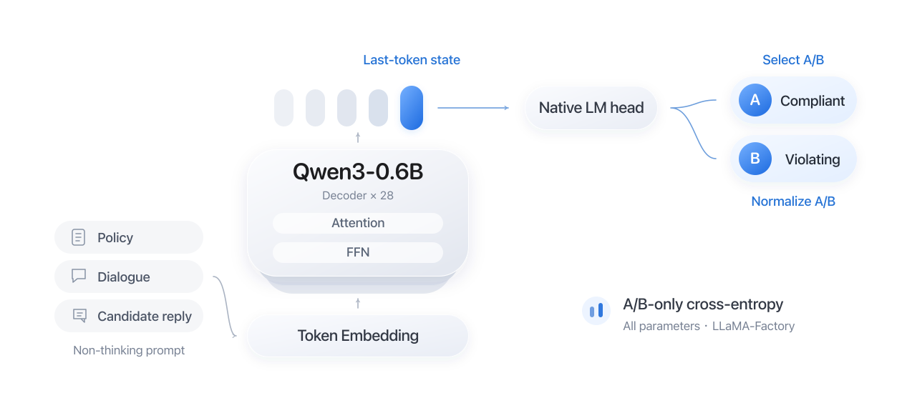

# Jev Customer Policy Verifier

English | [Chinese](README.zh-CN.md)

A customer-service policy compliance classifier built with **Qwen3-0.6B and LLaMA-Factory**. Inspired by SemIf-OpenJev's prompting and option-scoring approach, this project implements synthetic data generation, fine-tuning of all model parameters, automated evaluation, and export in the standard Qwen format.

The model trained on **7,227 original and synthetic examples** achieves **96.08% accuracy and 0.9607 macro F1** on **790 test examples split by dialogue group**.

Given a business policy (`policy`), dialogue history (`conversation`), and a proposed reply (`candidate_response`), the model returns `compliant` or `violating`. It checks the requirements applicable at the current dialogue step, allowing valid intermediate actions.

## Data Construction

The dataset uses **TOD-ProcBench Task 2 English data**, covering 55 business intents. Original dialogue groups are assigned to training, validation, or test splits. Synthetic examples are generated only from the training split and retain their source group, keeping related dialogues within the same split.

| Split | Examples | Composition |
| --- | ---: | --- |
| Training | **7,227** | 2,442 original + 4,785 synthetic |
| Validation | 730 | Fixed original examples for model selection |
| Test | 790 | Fixed original examples for final evaluation |

The synthesis workflow is **scenario extraction → constrained rewriting → validation and deduplication**:

- Extract the current business scenario from the policy and dialogue, then use a generation model through OpenRouter to rewrite the dialogue and proposed reply while preserving conditions, exceptions, action order, and the original compliance relationship.
- Check policy references, dialogue structure, placeholders, and duplicates. Retain provenance, generation versions, and quality status. Synthetic labels are inherited from source examples and checked through programmatic validation and limited manual spot checks.
- Save requests, responses, and content digests to support caching, retries, and interrupted-run recovery. The final data bundle includes file hashes for reproducible builds and consistency checks.

See the [training data specification](docs/data/training-data.md) and [batch generation guide](docs/guides/bulk-generation.md).

## Model Training and Framework Extensions

### Jev Classifier Architecture



The classifier reuses **Qwen3-0.6B's native language-model head**. It reads the A/B token logits from the final prompt position and normalizes them over these two options to obtain compliance probabilities. Training updates all model parameters with cross-entropy restricted to A/B; training and inference share the same non-thinking prompt and scoring protocol.

Input evidence is limited to the three business fields, with their text normalized to lowercase. Labels, sample IDs, and generation analysis are used for supervision or record management.

### From JSON Input to a Classification

**Original JSON**: a proposed refund reply to review.

```json
{
  "policy": "A refund is allowed only within seven days of purchase.",
  "conversation": ["User: I purchased this twenty days ago. Can I get a refund?"],
  "candidate_response": "Agent: Your refund is approved."
}
```

↓ **Lowercase the three fields, serialize them into `evidence`, and add the criterion and A/B options.**

**Jev prompt**: the system instruction, criterion, and option descriptions are abbreviated below; `evidence` preserves the actual serialized content.

System: apply the criterion to the evidence and return one option letter. The user message contains:

```json
{
  "evidence": "{\"candidate_response\":\"agent: your refund is approved.\",\"conversation\":[\"user: i purchased this twenty days ago. can i get a refund?\"],\"policy\":\"a refund is allowed only within seven days of purchase.\"}",
  "criterion": "Does the candidate response comply with the policy at the current conversation step?",
  "options": [
    {"letter": "A", "description": "Compliant"},
    {"letter": "B", "description": "Violating"}
  ]
}
```

↓ **Apply Qwen's chat template: the complete question is supplied, and the assistant's answer is left empty.** A simplified view of the conversation:

```text
system: Judge the evidence and answer only A or B.
user: Refunds are allowed within seven days; the purchase was twenty days ago;
      the agent approved the refund. A = compliant, B = violating.
assistant:
```

After processing the full prompt, Qwen passes the **hidden state of the last input token**, which incorporates the preceding context, through its native language-model head to score the next token across the vocabulary. The classifier selects the A/B scores and normalizes only those two values into compliance probabilities. Non-thinking mode suppresses reasoning output. The following scores and probabilities are illustrative:

```text
A/B scores: [1.2, 3.2] → A/B probabilities: [0.1192, 0.8808] → B (violating)
```

Illustrative output:

```json
{
  "label": "violating",
  "probabilities": {"compliant": 0.1192, "violating": 0.8808}
}
```

### LLaMA-Factory Extensions

The repository extends LLaMA-Factory through a subclass of **`CustomSeq2SeqTrainer`**, a data collator, and callbacks:

- **Custom loss and evaluation**: override `compute_loss` and `prediction_step` to compute A/B-restricted cross-entropy and retain only the two option logits during evaluation.
- **Reliable training and resumption**: handle gradient accumulation and restored sampling order, support full checkpoint recovery, and validate data and configuration consistency.
- **Model selection and delivery**: select the model by validation cross-entropy, with TensorBoard support, independent reload verification, and export in the standard Qwen format.

See [factory_trainer.py](src/customer_policy_verifier/training/factory_trainer.py), [factory_workflow.py](src/customer_policy_verifier/training/factory_workflow.py), and the [framework integration notes](docs/design/llamafactory-training.md).

## Evaluation Results

The experiment fine-tuned all parameters of the pretrained Qwen3-0.6B model on an RTX 4090 using **7,227 original and synthetic training examples**. The model was selected on the validation split and frozen before independent test evaluation.

| Metric | Validation (730 examples) | Test (790 examples) |
| --- | ---: | ---: |
| Accuracy | **96.58%** | **96.08%** |
| Macro F1 | **0.9658** | **0.9607** |

The model correctly classified **759 / 790 test examples**. Prediction coverage and data and weight digests were checked; metrics were recomputed from per-example predictions, and the selected model passed an independent reload check. These results apply to the fixed dialogue-group split of the TOD-ProcBench Task 2 English customer-service task.

See the [evaluation report](docs/reports/case-neutral-1epoch-results-20261004.md) for the full metrics and verification evidence.

## Usage

Run the following commands from the project root with Python 3.12. For a local environment:

```bash
python3.12 -m venv .venv
source .venv/bin/activate
python -m pip install -r requirements/training.txt
python scripts/cpv.py --help
```

For GPU training, install the CUDA-compatible dependencies described in the [AutoDL environment guide](docs/guides/autodl-environment.md).

**Prepare data and the model**: place the frozen training bundle in `data/training/task2-v1/` (see the [data directory index](data/README.md) for required files), validate it, and download the backbone.

```bash
python scripts/cpv.py train check --config configs/jev-training-case-neutral-1epoch.json
python scripts/cpv.py train download --config configs/jev-training-case-neutral-1epoch.json
```

**Train and test**: train on the combined dataset, then evaluate the selected model. Use a new directory for each training run.

```bash
python scripts/cpv.py train train \
  --config configs/jev-training-case-neutral-1epoch.json \
  --train-set mixed \
  --run-dir runs/training/mixed-demo

python scripts/cpv.py train evaluate \
  --config configs/jev-training-case-neutral-1epoch.json \
  --checkpoint runs/training/mixed-demo/best.safetensors \
  --split test \
  --output runs/training/mixed-demo/test-report.json
```

The selected weights are saved as `best.safetensors`; the standard model and tokenizer are exported to `export/`. Evaluation produces metrics and per-example probabilities. See the [training guide](docs/guides/jev-training.md) for resuming training and using custom data.

## Repository and Documentation

The GitHub repository contains source code, configurations, tests, documentation, and data indexes. Actual datasets, model weights, and run artifacts are kept locally. Full training requires the frozen data bundle to be prepared separately; see the [GitHub preparation guide](docs/guides/github.md) for the publication scope.

| Directory | Contents |
| --- | --- |
| `src/customer_policy_verifier/` | Data synthesis, validation, training, and evaluation |
| `scripts/` | CLI and execution entry points |
| `configs/`, `requirements/` | Experiment configurations and dependencies |
| `tests/` | Data processing, training numerics, resumption, and export tests |
| `docs/` | Guides, design notes, and experiment reports |

The linked detailed guides and reports are currently in Chinese. See the [documentation index](docs/README.md) for more.

## References

- [TOD-ProcBench](https://www.amazon.science/publications/tod-procbench-benchmarking-complex-instruction-following-in-task-oriented-dialogues): task and dataset source.
- [Qwen3-0.6B](https://www.modelscope.cn/models/Qwen/Qwen3-0.6B): pretrained backbone.
- [SemIf-OpenJev](https://github.com/TheoLeeCJ/SemIf-OpenJev/tree/23cf1f39fc9534fe81437200959b6dfc7106e45a): prompting and option-scoring reference; [MIT license](LICENSES/semif-openjev-MIT.txt) included.
- [LLaMA-Factory](https://github.com/hiyouga/LlamaFactory/tree/v0.9.5): training framework.

Reference code licenses and the distribution terms for data and model weights apply separately. The repository retains the license files for the reference code it uses.
