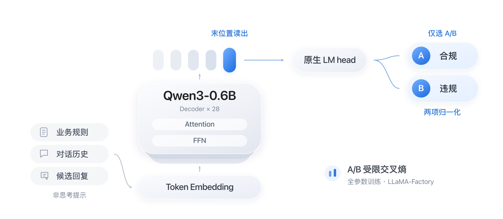

# Jev 客服规则合规判别

[English](README.md) | 简体中文

**Jev Customer Policy Verifier**：基于 Qwen3-0.6B 与 LLaMA-Factory 的客服业务规则合规判别项目。参考 SemIf-OpenJev 的提示与选项读取方法，完成数据合成、全参数训练、自动评测和标准模型导出。

构建 **7,227 条训练数据**，混合数据训练模型在 **790 条按对话组隔离的测试样本**上取得 **96.08% 准确率、0.9607 宏 F1**。

模型接收业务规则 `policy`、对话历史 `conversation` 和待审核回复 `candidate_response`，输出 `compliant`（合规）或 `violating`（违规）。判断依据是回复是否符合当前步骤适用的业务规则，允许合理的中间步骤。

## 数据构建

数据来自 **TOD-ProcBench Task 2 英文数据**，覆盖 55 类业务意图。按原始对话组划分训练、验证和测试集；合成样本仅由训练分区生成，并继承来源分组，避免同源对话跨分区。

| 数据集 | 样本数 | 构成 |
| --- | ---: | --- |
| 训练集 | **7,227** | 2,442 条原始样本 + 4,785 条合成样本 |
| 验证集 | 730 | 固定原始样本，用于模型选择 |
| 测试集 | 790 | 固定原始样本，用于最终评测 |

合成流程采用“**场景提取 → 约束改写 → 校验与去重**”：

- 先从规则与对话中提取当前业务场景，再通过 OpenRouter 调用生成模型改写对话及候选回复，保留条件、例外、操作顺序和原有合规关系。
- 对规则引用、对话结构、占位符及重复样本进行程序检查，保留来源、生成版本和质量状态。合成标签继承源样本，采用程序校验及少量抽查。
- 保存请求响应与内容摘要，支持缓存、失败重试和中断恢复；最终数据包记录文件哈希，支持重复构建和一致性核验。

数据格式与构建说明见 [训练数据说明](docs/data/training-data.md)，合成操作见 [批量生成指南](docs/guides/bulk-generation.md)。

## 模型训练与框架扩展

### Jev 分类器结构



Jev 分类器复用 **Qwen3-0.6B 的原生词表头**：取提示末位置的隐藏向量，读取 A/B 两个 token 的 logits，并在两项之间归一化，得到合规/违规概率。全参数训练使用 A/B 受限交叉熵；训练与推理使用一致的非思考提示与读分协议。

输入统一归一化，只包含三个业务字段；标签、样本编号及生成分析作为监督或管理信息。

### 从 JSON 输入到分类结果

**原始 JSON**：一条待审核的退款回复。

```json
{
  "policy": "A refund is allowed only within seven days of purchase.",
  "conversation": ["User: I purchased this twenty days ago. Can I get a refund?"],
  "candidate_response": "Agent: Your refund is approved."
}
```

↓ **三个字段统一小写并序列化为 `evidence`，再补入判定问题和 A/B 选项。**

**Jev 判别提示**（system、问题与选项用中文概述，`evidence` 保留实际序列化内容）：

system：依据证据和标准，只回答一个选项字母。user 的内容为：

```json
{
  "evidence": "{\"candidate_response\":\"agent: your refund is approved.\",\"conversation\":[\"user: i purchased this twenty days ago. can i get a refund?\"],\"policy\":\"a refund is allowed only within seven days of purchase.\"}",
  "criterion": "候选回复是否符合当前对话步骤的规则？",
  "options": [
    {"letter": "A", "description": "合规"},
    {"letter": "B", "description": "违规"}
  ]
}
```

↓ **套入 Qwen 聊天模板：题目输入完整，assistant 的答案留空。** 对话结构简化如下：

```text
system：依据证据判断，只回答 A 或 B。
user：七天内可退款；用户已购买二十天；客服批准退款。
      A = 合规，B = 违规。
assistant：
```

Qwen 处理完整提示后，用**最后一个输入 token 的隐藏状态**（已融合前文信息），经原生词表头得到下一个 token 的词表分数。分类器取出 A/B 两项分数，仅在二者之间归一化，得到合规/违规概率。采用非思考模式，不输出推理文字。以下分数和概率为演示值：

```text
A/B 分数：[1.2, 3.2] → A/B 概率：[0.1192, 0.8808] → B（违规）
```

对应的输出示意：

```json
{
  "label": "violating",
  "probabilities": {"compliant": 0.1192, "violating": 0.8808}
}
```

### LLaMA-Factory 扩展

为支持该训练目标，在本仓库内通过继承 **LLaMA-Factory `CustomSeq2SeqTrainer`**、数据整理器和回调实现扩展：

- **自定义损失与评测**：重写 `compute_loss` 和 `prediction_step`，实现 A/B 受限交叉熵，评测仅保留两项 logits。
- **可靠训练与续训**：适配梯度累积及恢复后的采样顺序，支持完整检查点恢复，并校验数据和配置的一致性。
- **选模与模型交付**：按验证集交叉熵选模，支持 TensorBoard、独立重载验证及标准 Qwen 格式导出。

核心实现见 [factory_trainer.py](src/customer_policy_verifier/training/factory_trainer.py) 与 [factory_workflow.py](src/customer_policy_verifier/training/factory_workflow.py)，设计说明见 [框架接入文档](docs/design/llamafactory-training.md)。

## 评测结果

正式实验在 RTX 4090 上使用真实预训练 Qwen3-0.6B，以 **7,227 条混合训练数据**完成全参数训练。模型由验证集选择并冻结后，再进行独立测试。

| 指标 | 验证集（730 条） | 测试集（790 条） |
| --- | ---: | ---: |
| 准确率 | **96.58%** | **96.08%** |
| 宏 F1 | **0.9658** | **0.9607** |

测试集正确判别 **759 / 790 条**。已核对预测覆盖、数据与权重摘要，并从逐样本预测重新计算指标；所选模型的独立重载检查通过。结果对应 TOD-ProcBench Task 2 英文客服任务的固定对话分组划分。

完整指标与验证依据见 [评测报告](docs/reports/case-neutral-1epoch-results-20261004.md)。

## 使用方法

以下命令在项目根目录执行。使用 Python 3.12；本地依赖安装示例：

```bash
python3.12 -m venv .venv
source .venv/bin/activate
python -m pip install -r requirements/training.txt
python scripts/cpv.py --help
```

GPU 训练环境请按 [AutoDL 环境指南](docs/guides/autodl-environment.md) 安装 CUDA 对应依赖。

**准备数据与模型**：将已有冻结训练包放入 `data/training/task2-v1/`（文件清单见 [数据目录说明](data/README.md)），校验数据并下载模型。

```bash
python scripts/cpv.py train check --config configs/jev-training-case-neutral-1epoch.json
python scripts/cpv.py train download --config configs/jev-training-case-neutral-1epoch.json
```

**训练与测试**：使用混合训练集运行，训练结束后评测所选模型。运行目录应为新的目录。

```bash
python scripts/cpv.py train train \
  --config configs/jev-training-case-neutral-1epoch.json \
  --train-set mixed \
  --run-dir runs/training/mixed-demo

python scripts/cpv.py train evaluate \
  --config configs/jev-training-case-neutral-1epoch.json \
  --checkpoint runs/training/mixed-demo/best.safetensors \
  --split test \
  --output runs/training/mixed-demo/test-report.json
```

所选权重保存为 `best.safetensors`，标准模型与 tokenizer 保存到 `export/`，测试命令输出指标和逐样本概率。续训及自定义数据的操作见 [训练指南](docs/guides/jev-training.md)。

## 代码与文档

**仓库内容**：GitHub 版本包含代码、配置、测试、文档和数据索引；实际数据、模型权重及运行产物保留在本地。完整训练需要另行准备冻结数据包，具体提交范围见 [GitHub 上传指南](docs/guides/github.md)。

| 目录 | 内容 |
| --- | --- |
| `src/customer_policy_verifier/` | 数据合成、校验、训练与评测实现 |
| `scripts/` | CLI 与运行入口 |
| `configs/`、`requirements/` | 实验配置与依赖 |
| `tests/` | 数据处理、训练数值、续训与导出测试 |
| `docs/` | 使用指南、设计说明与实验报告 |

更多资料见 [文档导航](docs/README.md)。

## 参考

- [TOD-ProcBench](https://www.amazon.science/publications/tod-procbench-benchmarking-complex-instruction-following-in-task-oriented-dialogues)：任务与数据来源。
- [Qwen3-0.6B](https://www.modelscope.cn/models/Qwen/Qwen3-0.6B)：预训练模型。
- [SemIf-OpenJev](https://github.com/TheoLeeCJ/SemIf-OpenJev/tree/23cf1f39fc9534fe81437200959b6dfc7106e45a)：提示及选项读取参考，附 [MIT 许可](LICENSES/semif-openjev-MIT.txt)。
- [LLaMA-Factory](https://github.com/hiyouga/LlamaFactory/tree/v0.9.5)：训练框架。

参考代码许可与数据、模型的分发条件分别适用；仓库保留所用参考代码的许可文件。
