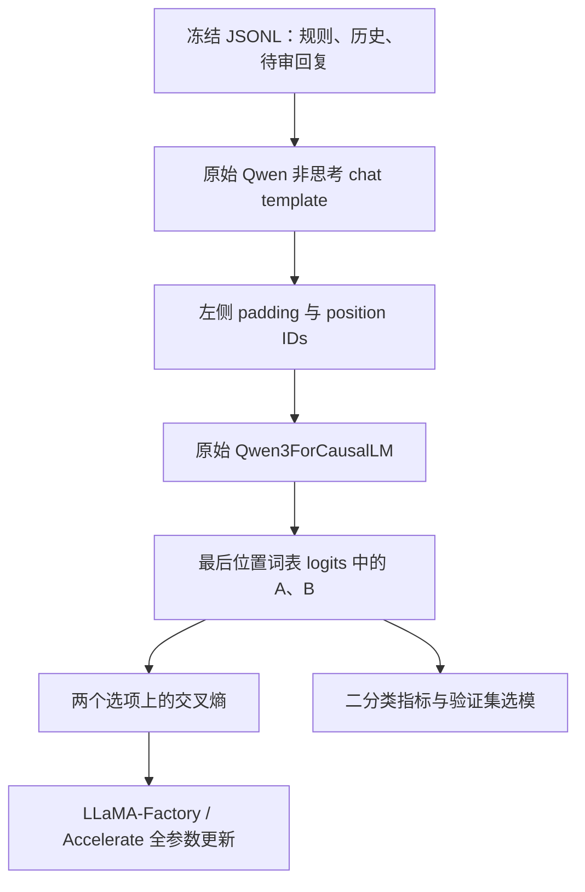

# LLaMA-Factory Direct 训练接入设计

本项目使用 **LLaMA-Factory 0.9.5 的 `CustomSeq2SeqTrainer` 子类**训练原始 Qwen3-0.6B。SemIf-OpenJev 提供 Direct 提示和读取方法的推理参考；项目负责监督目标、数据适配、验证选模和评估。

## 数据与模型路径

模型结构、词表和原生共享词嵌入保持原样。训练样本的正确类别只成为 `[1,0]` 或 `[0,1]` 的监督目标，不追加到输入。模型仅接收规则、对话历史和待审回复；ID、来源、审核解释与标签元数据不进入前向。

## 为什么需要自定义 Trainer

通用文本 SFT 对完整词表进行下一 token 交叉熵。本项目仅对 A/B logits 归一化，正确选项的目标 token 不与其余词表 token 竞争。因此直接使用普通 SFT 数据加 YAML 会改变目标函数。

[factory_trainer.py](../../src/customer_policy_verifier/training/factory_trainer.py)重写 `compute_loss` 和 `prediction_step`，复用原有数值读取与损失代码。`model_accepts_loss_kwargs=False` 明确告诉 Trainer：损失已是每个问题的平均值，不使用通用 token 数量归一化；Trainer 按实际梯度累积次数缩放一次。评测只累计每条样本两个 logits，避免保留全部序列词表输出。

[factory_workflow.py](../../src/customer_policy_verifier/training/factory_workflow.py)负责建立框架参数、冻结数据适配、初始验证、选择回调和续训校验。优化器、调度、设备、bf16、梯度累积、裁剪、采样和完整检查点由框架执行。训练类型为 `full`，所有原生参数使用同一学习率；AdamW 按框架默认区分权重衰减与无需衰减的参数。

当前默认 `num_train_epochs=3`、`max_steps=-1`，通过已安装 Trainer 的预算计算接口记录 `training_plan`，训练结束校验实际更新次数与完整轮数。各轮末尾的较短累积窗口也更新，原始/混合训练默认分别为 459 / 1,356 次更新。`smoke` 保留两步预算。

TensorBoard 使用框架的原生回调生命周期，事件保存到各实验的 `tensorboard/`。`ScalarTensorBoardCallback` 仅传递标量，避免将混淆矩阵列表交给标量 writer；结构化指标仍完整写入 JSON。每 20 步记录训练曲线，初始验证、每 100 步及最后一步记录验证曲线。

这是专用 Direct 工作流，入口是 `python scripts/cpv.py train train`，不是把配置直接传给普通 `llamafactory-cli train`。配置位于 [jev-training.json](../../configs/jev-training.json)，框架库作为依赖安装，不修改第三方安装目录。

## 选模、续训与导出

| 产物 | 含义 |
| --- | --- |
| `best.safetensors` | 验证集交叉熵最优的完整模型，候选包含第 0 步 |
| `checkpoints/checkpoint-N/` | 第 N 步训练状态，供恢复优化器、调度和 RNG；默认保留最近两个 |
| `checkpoints/checkpoint-N/cpv_resume.json` | 对应时刻的最佳模型选择状态、计划总步数与累计耗时；`cpv_best.safetensors` 硬链接保留对应选择 |
| `tensorboard/` | TensorBoard 训练与验证标量；续训沿用同一目录和已恢复步数 |
| `export/` | 验证集选中模型的标准 Qwen 配置、safetensors、正式 tokenizer 和 Direct 元数据 |
| `selection.json` / `reload_check.json` | 完成训练后冻结的选择结果和独立重载一致性 |

续训只接受该运行目录的最新完整检查点，要求数据、提示、样本子集、配置、代码和框架版本与原运行一致。框架恢复其余训练状态；这些校验针对同一次实验的连续性，不将下载模型的提交或文件内容设为版本锁。

训练不会自动评测最终测试集。两组实验从同一缓存的原始预训练模型分别初始化，各遍历训练集三轮；混合组更新次数和计算量更大，报告同时记录 optimizer steps 与实际 epoch。

跨轮续训使用 `EpochSeededSampler`：按数据 seed 加上 Trainer 当前/恢复的 epoch 生成排列，保持单卡随机采样。在 Accelerate 1.11 的 `skip_first_batches` 新建加载器时，其 iteration 会回到 0；该采样器从恢复的 Trainer 状态取得轮次，避免恢复第二轮或更晚轮次时改用第 0 轮排列。训练循环、数据跳过、优化器和 RNG 恢复继续由框架执行。

## 本地验证

离线小模型检查覆盖：A/B CE 与完整词表 CE 的区别、累积梯度与整批梯度一致、三轮样本完整覆盖、第二轮中途续训后的最终权重与连续训练逐 tensor 一致、第 0 步选择保留、标准导出与所选权重一致、真实 TensorBoard 事件读回。当前检查见 [三轮训练与日志记录](../reports/tensorboard-epochs-20261004.md)，torch 2.6.0 / cu124 的安装依据见 [环境验证记录](../reports/autodl-cu124-20261004.md)。真实 CUDA 性能与模型效果以 AutoDL 正式实验为准。
